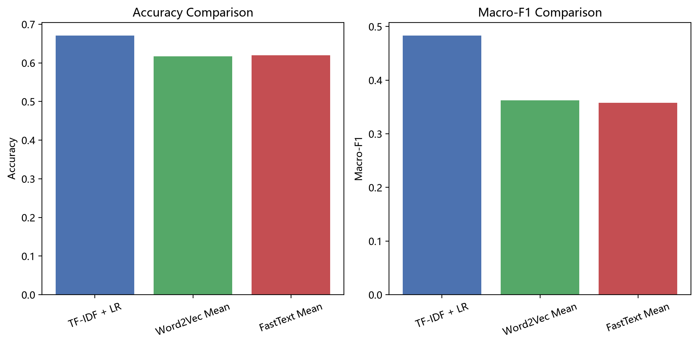
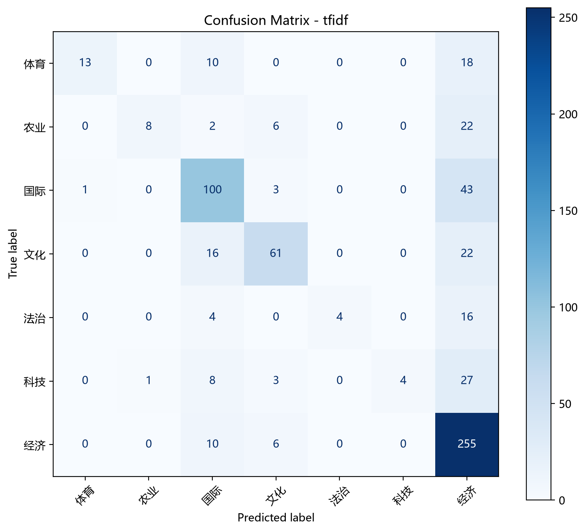

# HW2中文文本分类实验报告

本次作业需要Gensim上手练习表示学习和进行文本分类实验。简单来说就是找个开源库把内容转换成不同的表示（比如分布式词向量表示），然后再进行文本分类的实验就可以了。为了方便，我直接使用人民日报的语料库对比Gensim不同的模型/表示方式的效果。下面是过程：

## 1. 摘要

基于人民日报 1998 年语料构建了一个中文新闻文本分类实验，比较了三种不同表示方式下的分类效果：TF-IDF + Logistic Regression、Word2Vec 平均向量和 FastText 表示。实验采用弱标签构造策略，并以 Accuracy 和 Macro-F1 作为主要评价指标。结果显示，TF-IDF + Logistic Regression 表现最佳，测试集上的 Accuracy 为 0.6712，Macro-F1 为 0.4835；Word2Vec 和 FastText 分别为 0.6169 / 0.3626 和 0.6199 / 0.3577。

## 2. 实验背景与目标

Gensim 是处理文本的python库。实验中使用了FastText直接用于分类，同时为了对比Gensim的各种方法，也添加了Word2Vec的使用，这个本质上是一个分布式词向量表示学习的工具，之后使用logistic regression当分类器。当然为了展示效果，还把传统的TF-IDF传统词袋模型作对比。与传统模型相比，分布式表示更关注语义相似性和上下文之间的联系。

在本实验中，重点关注两点：一是比较不同文本表示方法在中文新闻分类任务中的性能；二是结合 Macro-F1 指标分析类别不均衡情形下的整体分类效果。该实验不仅关注整体准确率，也关注各类别样本分布不均时模型的综合性能。

## 3. 数据与标签构造

数据来源为人民日报 1998 年语料（People’s Daily 1998），语料中包含大量中文新闻文本及对应标签信息。预处理阶段首先去除无效符号和停用表达，再对文本进行分词和清洗，保留具有语义意义的词语。随后，结合文章标题和类别关键词规则，用弱标签方式为样本生成类别标签，最终形成七个主要类别：体育、农业、国际、文化、法治、科技、经济。

由于真实语料中的类别分布并不完全均衡，因此本实验以 Macro-F1 作为核心评估指标，以减少大类对整体结果的掩盖作用，并更真实地反映多类别分类任务下的综合表现。

## 4. 实验设计

本实验采用三种建模方案：

1. TF-IDF + Logistic Regression采用词频逆文档频率特征并结合线性分类器，作为传统基线模型。
2. Word2Vec 平均向量利用 Gensim 训练词向量，并对文本中单词向量取平均，得到文档级表示，然后使用 Logistic Regression 进行分类。
3. FastText
   利用字符级和词级特征学习文本表示，构建更具语义密度的文档向量表示，并进行分类。

实验中将数据按 6:2:2 划分为训练集、验证集和测试集，并在测试集上记录 Accuracy 与 Macro-F1。该设计能够直接比较传统稀疏表示与分布式表示在新闻分类任务中的差异，并为后续的模型优化提供基线。

## 5. 实验结果

表 1 为三种方法在测试集上的整体结果。

| 方法                         | Accuracy | Macro-F1 | 说明                             |
| ---------------------------- | -------: | -------: | -------------------------------- |
| TF-IDF + Logistic Regression |   0.6712 |   0.4835 | 最优                             |
| Word2Vec Mean                |   0.6169 |   0.3626 | 表现明显低于 TF-IDF              |
| FastText Mean                |   0.6199 |   0.3577 | 略优于 Word2Vec，但仍弱于 TF-IDF |

为了更直观地展示模型差异，下面给出对比图。



另外，TF-IDF 模型的混淆矩阵也用于辅助分析其误差分布。



## 6. 讨论分析

实验结果表明，TF-IDF + Logistic Regression 在本任务中明显优于 Word2Vec 和 FastText。原因可能在与：

第一，中文新闻文本中往往存在明显的关键词特征，如“经济”“科技”“体育”等词汇，这些词在词袋表示中能直接体现类别差异。TF-IDF 通过词频与逆文档频率加权，使这些类别区分性词语更突出，从而提升了分类边界的稳定性。

第二，Word2Vec 和 FastText 虽然具备更强的语义表达能力，但在当前实验的语料规模和弱标签设定下，分布式表示方法并未能够充分学习出稳定且足够强的类别判别特征。尤其在新闻文本语境中，类别差异很大程度上依赖于关键词和语义组合，简单的词向量平均容易丢失这类信息。

## 8. 结论

在本实验中，传统 TF-IDF 特征表示依然是最稳妥的基线方法，而 Gensim 的 Word2Vec 和 FastText 作为表示学习和文本分类方法，展示了语义建模能力，但在当前任务中仍未超过传统稀疏表示的效果。

## 9. 复现说明

代码目录说明：

- `main.py`：入口脚本，负责数据读取、预处理和模型训练
- `src/preprocess.py`：语料清洗与样本构造
- `src/train_models.py`：三类模型训练与评估
- `plot_results.py`：生成结果对比图
- `plot_confusion_matrix.py`：生成混淆矩阵图

运行方式：

```bash
cd gensim_text_classification_lab
python main.py
python plot_results.py
python plot_confusion_matrix.py
```

## 10. 参考文献

[1] Mikolov, T., Chen, K., Corrado, G., & Dean, J. (2013). Efficient Estimation of Word Representations in Vector Space.

[2] Joulin, A., Grave, E., Bojanowski, P., & Mikolov, T. (2017). Bag of Tricks for Efficient Text Classification.

[3] Rehurek, R., & Sojka, P. (2010). Software Framework for Topic Modelling with Large Corpora.
